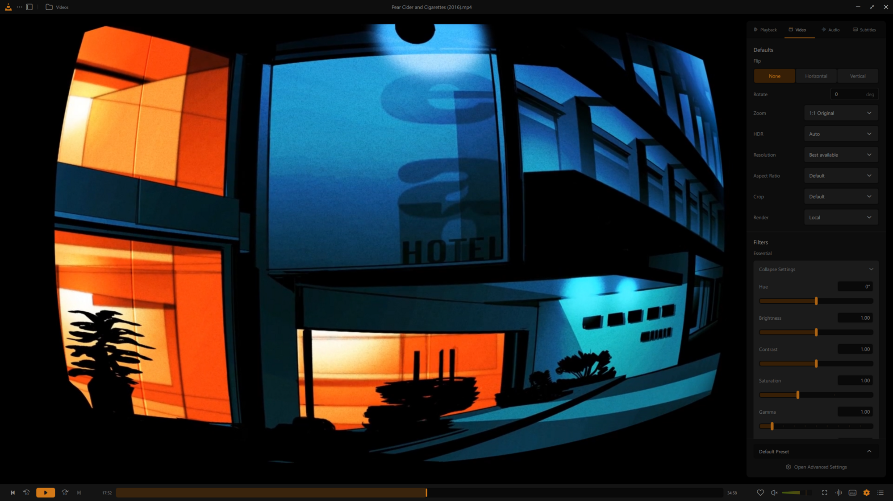
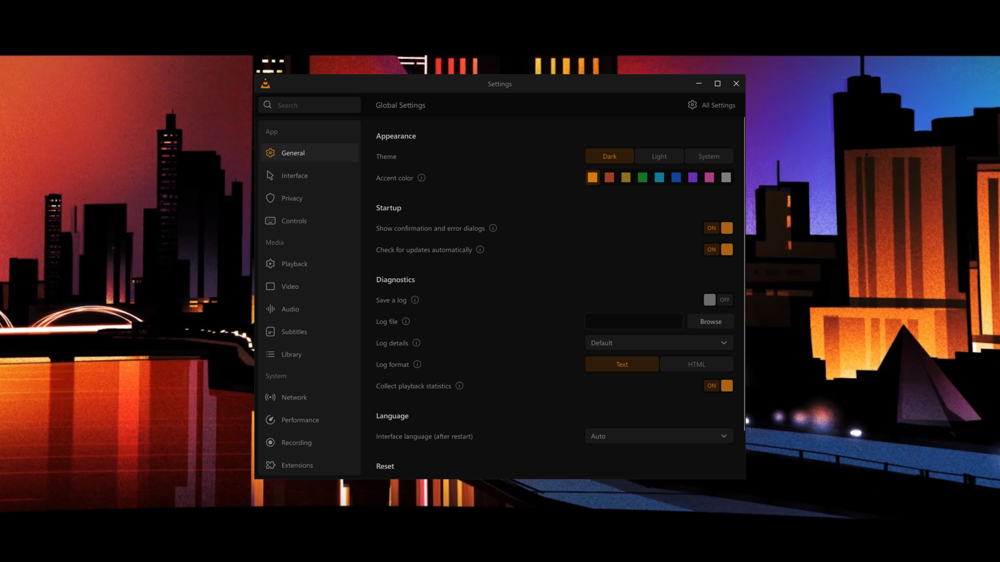
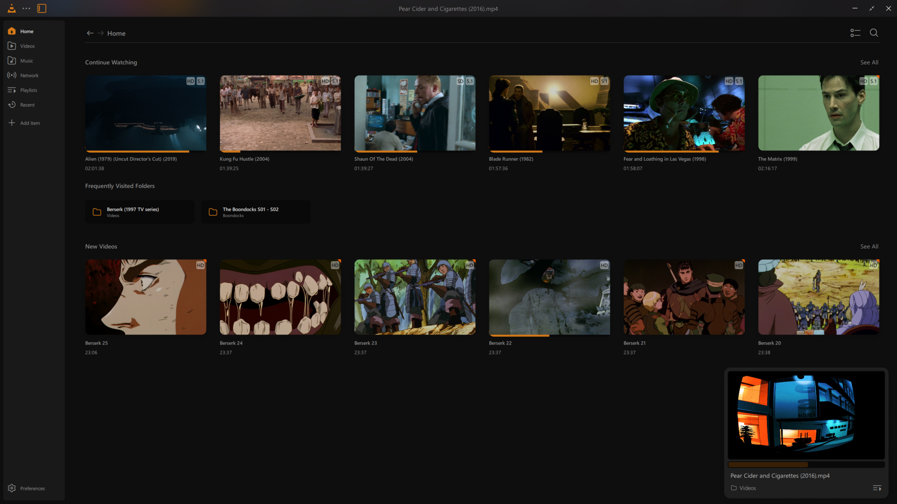
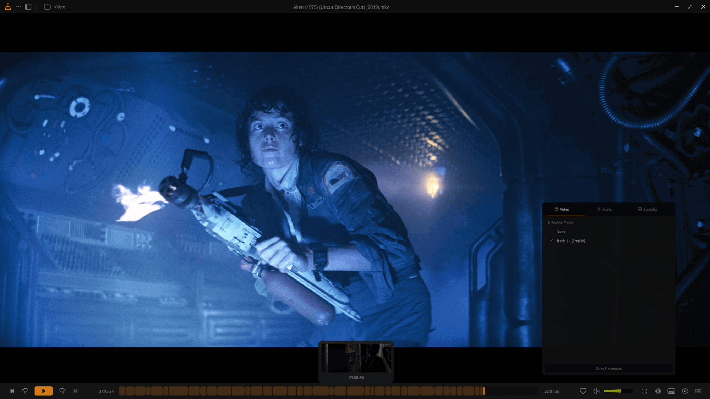

# VLC Gold

A media player with a new interface, built on VLC 4.0 and its Qt/QML interface, following
the community design "VLC Redesign" by Juxtopposed.

[](COPYING)
[](https://creativecommons.org/licenses/by/4.0/)
[](#download-and-install)

> [!NOTE]
> VLC Gold is built on the development version of VLC 4.0, which is not released yet.
> Please report problems in the
> [issue tracker](https://github.com/oliver-bacon/vlc-gold/issues).

It is based on VLC master (4.0 development version, commit `1176b56`). The work is in
the Qt interface (`modules/gui/qt`), plus a few small changes elsewhere listed in
[CHANGELOG.md](CHANGELOG.md). The original VLC README is in
[README.upstream.md](README.upstream.md).

## Screenshots

| Player | Settings |
|:---:|:---:|
|  |  |
| Library home | Seek bar preview |
|  |  |

## Features

**Design**
- The look of the "VLC Redesign" design: new colours, icons, menus and dialogs, dark and
  light themes, and an accent colour you can change (the cone logo follows it)
- Onboarding on first start: media folder, theme, accent colour and basic shortcuts

**Player**
- One-row player bar with a large seek bar, the cone-shaped volume, and buttons for audio,
  subtitles, playback settings and the queue
- Seek bar with preview thumbnails for videos, a subtitle timeline and a waveform for music
- Playback settings and the queue open as a panel on the right: speed, sleep timer, flip,
  rotate, zoom, crop and other video options, video effects, equalizer and audio effects,
  subtitle delay and look; also for music
- Presets that save all playback settings at once (filters, delays, flip, subtitle look)
- Find and download subtitles from [OpenSubtitles](https://www.opensubtitles.com/) for a
  video, a folder or a playlist
- Favorites, "Continue watching", and a reorganized right-click menu with "Hide UI"
- DVD menus stay free of the bars; move the pointer to the top or bottom edge to show them
- New default keys: Record is `R`, Hide UI is `Ctrl+\`

**Library**
- Home with Continue Watching, Listen Again and Frequently Visited Folders
- Videos by folder with clickable paths; Music by songs, albums, artists and genres;
  folders added from Music stay out of Videos
- Network streams, podcasts and radio
- Grid or list view on the library pages
- A compact library panel inside the player, and a mini player

**Settings**
- A new settings window with search, built on VLC's own options, including Reset
  preferences
- All Settings: every VLC option and module in the same window, in the same style
- Settings profiles (Movies, Shows, Music, Work, …) that switch everything at once
- Customize Player: edit the player bars in place, with new buttons such as Favorite,
  picture-in-picture, ±15 s, Chapters, HDR and Thumbnail; the seek bar can be moved too, or put in its own
  row above the bar
- Subtitles and audio tracks can be added to a file, folder or playlist and are loaded
  every time

**Windows and dialogs**
- Every window in the style of the settings window, with all the options of the old ones:
  Open Media, Media Information, Adjustments and Effects, Convert and Stream Output,
  Messages, Plugins and extensions, VLM, Program Guide, Bookmarks and more
- Effects window with sliders that show their steps and fields to type exact values
- Check for Updates: tells you when a newer release is out (once a day, can be turned off)
- Redesigned icons in VLC's menus, and yes/no questions in the redesign's style

## Download and install

### Windows (10 or 11, 64-bit)

Download from the [Releases](https://github.com/oliver-bacon/vlc-gold/releases) page. You can
check a download against `SHA256SUMS.txt` from the same release:
`certutil -hashfile <file> SHA256`.

**Portable (recommended):** `vlc-gold-<version>-win64.zip` or `.7z`. Extract it anywhere and
run `vlc.exe`. Nothing is installed.

**Installer:** `vlc-gold-<version>-win64.exe`. It installs into the same folder as VLC
(`C:\Program Files\VideoLAN\VLC`), **replacing an installed VLC** and its file
associations. Use it only if you do not need VLC from [videolan.org](https://www.videolan.org/)
on the same PC; reinstall VLC from there to go back.

Notes:
- The build is not code-signed, so Windows SmartScreen may warn before the first start.
- It uses the same settings folder as VLC (`%APPDATA%\vlc`). If you also use VLC 4
  development builds from videolan.org, back that folder up first.
- If you used an earlier build: open **Customize Player** and click **Restore Default**
  to get the new player bar.

### Linux (64-bit)

VLC Gold is available for Linux as an AppImage: a single executable file that requires
no installation or compilation. Download `VLC_Gold-<version>-x86_64.AppImage` from the
[Releases](https://github.com/oliver-bacon/vlc-gold/releases) page. It runs on 64-bit
distributions with glibc 2.35 or newer (released 2022 or later), for example Ubuntu 22.04,
Debian 12, Fedora 36, Linux Mint 21 and current Arch Linux.

Tested on Arch Linux with KDE Plasma (in a virtual machine). In automated tests without a
desktop it also starts and plays video on Debian 12, Fedora 44 and Arch Linux.

1. Make it executable: right-click › Properties › "Allow executing file as program", or
   `chmod +x VLC_Gold-*-x86_64.AppImage`.
2. Double-click it, or run `./VLC_Gold-*-x86_64.AppImage` (add a file to play it).

Nothing is installed and an installed VLC is not modified; to remove it, delete the file.
Optional: compare the SHA-256 with `SHA256SUMS.txt` from the same release
(`sha256sum -c SHA256SUMS.txt --ignore-missing`).

Notes:
- **App menu and "Open with":** the AppImage doesn't add itself. Tools like
  [Gear Lever](https://flathub.org/apps/it.mijorus.gearlever) or
  [AppImageLauncher](https://github.com/TheAssassin/AppImageLauncher) add it with one click.
- It uses the same settings folder as VLC (`~/.config/vlc`) and the same media library
  (`~/.local/share/vlc`). If you use your distribution's VLC, back up those folders first.
- If it doesn't start because FUSE is missing (some minimal or container setups), run it
  with `--appimage-extract-and-run`.

To build the AppImage yourself, or to build and install from source (experimental), see
[VLC Gold on Linux](docs/building-linux.md).

## Building from source

### Windows (Docker, recommended)

From the repository root, with Docker (on Linux or in WSL):

```sh
docker run --rm -it --user root -v "$PWD":/vlc -w /vlc \
  registry.videolan.org/vlc-debian-win64-posix:20260611225331 \
  bash -c 'git config --global --add safe.directory /vlc && extras/package/win32/build.sh -a x86_64 -p -r -i r'
```

This uses VideoLAN's own build image. The first run takes long because it also builds
VLC's dependencies. Output: `win64/vlc-gold-<version>/vlc.exe` and the packages
`win64/vlc-gold-<version>-win64.zip` / `.7z` / `.exe`; debug symbols in
`win64/symbols-gold-<version>/`.

### Linux

For running VLC Gold, the AppImage is sufficient (see [Linux](#linux-64-bit)).
Instructions for building the AppImage, or for building and installing from source
(experimental), are in [VLC Gold on Linux](docs/building-linux.md).

## Credits and attribution

**Design:** ["VLC Redesign"](https://www.figma.com/community/file/1691465999134370980/vlc-redesign)
by [Juxtopposed](https://www.juxtopposed.com/), licensed under
[CC BY 4.0](https://creativecommons.org/licenses/by/4.0/). See also the designer's
[redesign video](https://www.youtube.com/watch?v=ERFeOgqk324).

**Changes were made:** this repository is an independent implementation of that design
in VLC's Qt/QML interface. Some parts differ from the design, and some are not
implemented yet. Icons and pictures from the Figma file were used, converted or adapted
(see [CREDITS.md](CREDITS.md)). Juxtopposed is not involved in this project and has not
endorsed it.

**VLC:** VLC Gold is based on VLC and its Qt interface. VLC is made by the
[VideoLAN team and VLC contributors](THANKS). "VLC", "VLC media player" and the cone logo
are trademarks of VideoLAN, which is not involved in this project.

**VLC Gold:** Oliver Bacon ([@oliver-bacon](https://github.com/oliver-bacon)).

**Third-party assets:** country flags from [flag-icons](https://github.com/lipis/flag-icons)
(MIT). Details in [CREDITS.md](CREDITS.md).

## License

- **VLC**, including the Qt interface and this project's code changes, is under the
  [GNU GPL, version 2 or later](COPYING). **libVLC** (the engine in `src/` and `lib/`)
  is under the [GNU LGPL, version 2.1 or later](COPYING.LIB). The Windows builds contain
  GPL modules, so the program as a whole is distributed under the GPL.
- **The design** (and the icons and pictures taken from the Figma file, see
  [CREDITS.md](CREDITS.md)) is by Juxtopposed and licensed under
  [CC BY 4.0](https://creativecommons.org/licenses/by/4.0/), not the GPL.
- Country flags: MIT, see `modules/gui/qt/pixmaps/flags/LICENSE`.
